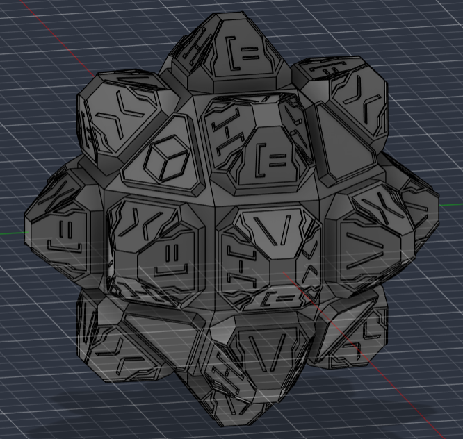
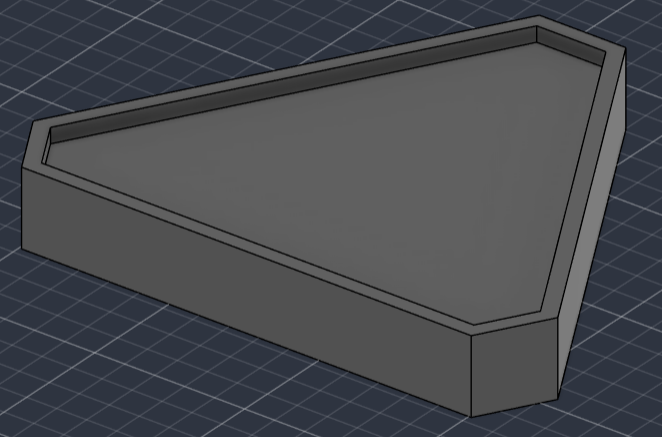
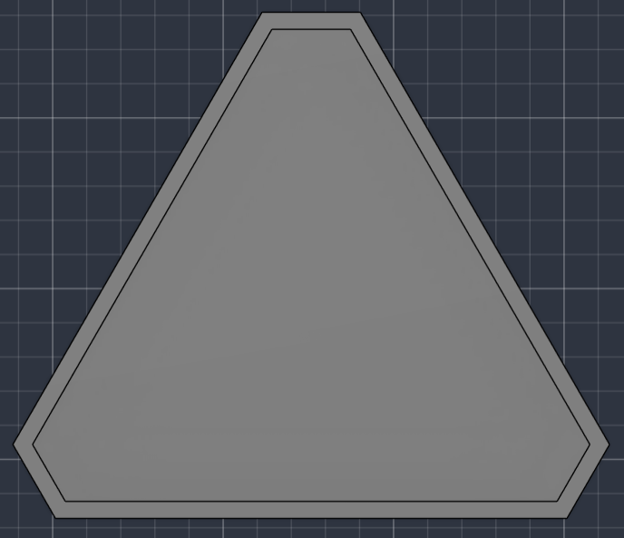
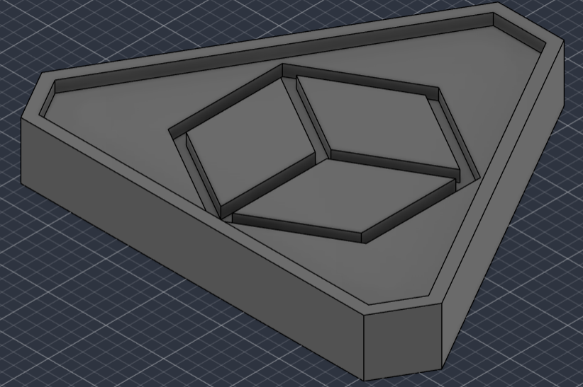
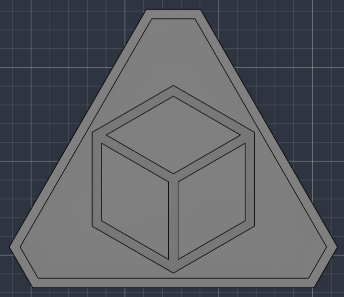
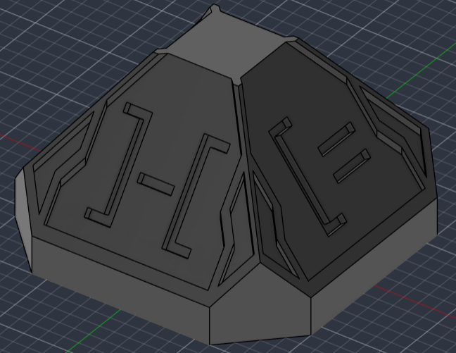
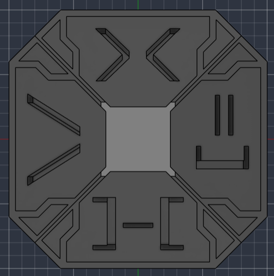
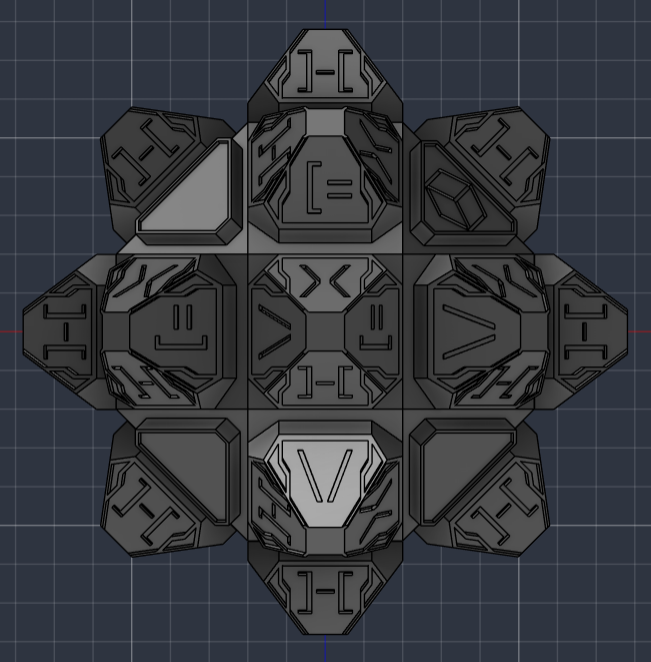

# Hexa Core

A 3D print based on the Hex Core from the show Arcane.

## Details
CAD made in Fusion 360

The model is meant to replicate the Hex Core from the show Arcane. There are four models in [/production](/production):
- **Core**: This is a [rhombicuboctahedron](https://en.wikipedia.org/wiki/Rhombicuboctahedron) intended as the base on which the remaining pieces need to be glued.
Only 1 of this piece is required.
- **Square piece**: These are the pieces to be glued on the square faces of the core. It has four faces with a glyph on each. They are stylized letters spelling out "HEXA".
18 pieces are required.
- **Triangle pieces (Smooth and regular)**: These are the pieces to be glued on the triangular faces of the core. The smooth version is blank while the regular version has a cube glyph.
8 pieces are required. They can be either smooth or regular. For my build, I'm using 2 regulars and 6 smooths with the regulars glued on opposite corners.

## About
I've always thought the Hex Core in Arcane looked very magical and futuristic, and I've
wanted to model it for years now. This project, originally for week 2 (CAD week) of Hack
Club's Half Life, is my attempt at making my own version of the object. The goal is to
have an intricate and beautiful looking design that can sit on a desk or shelf, looking cool.

Originally, I planned for it to be built on top of a Rubik's cube core so it could turn and
twist just like the real version in the source material. Unfortunately, I ended up having to
make it static due to time constraints and me underestimating the complexity involved.

## Images

### Pieces

| | | |
| - | - | - |
| Blank Triangle Piece |  |  |
| Triangle Piece |  |  |
| Square Piece |  |  |
| Build |  |  |
